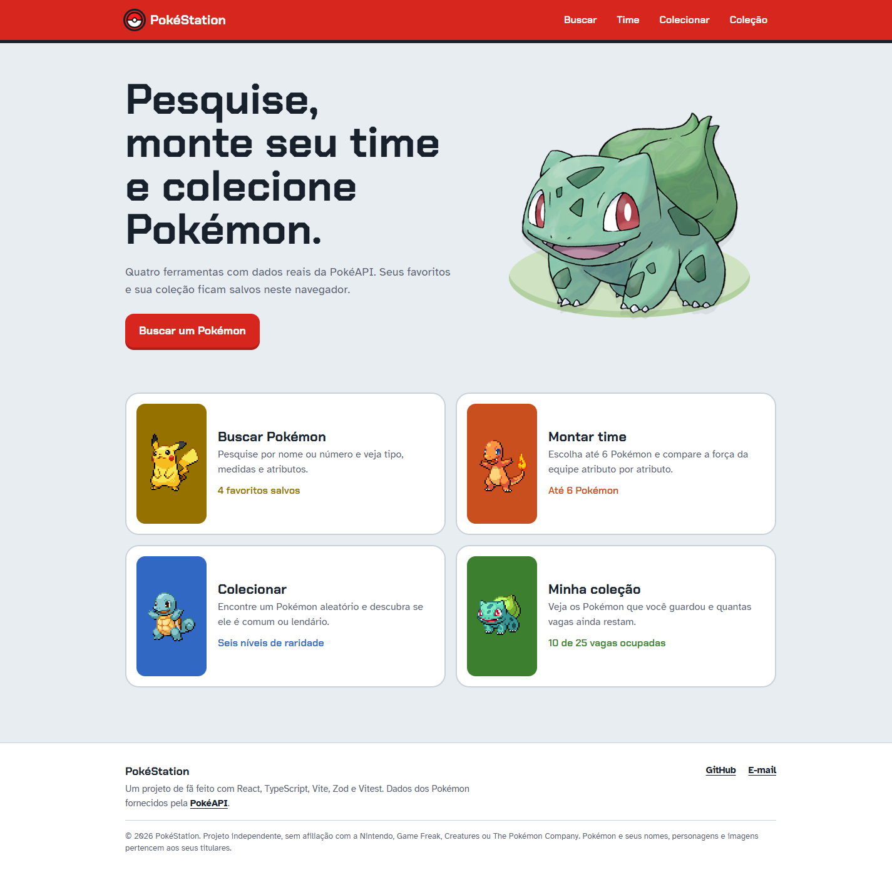
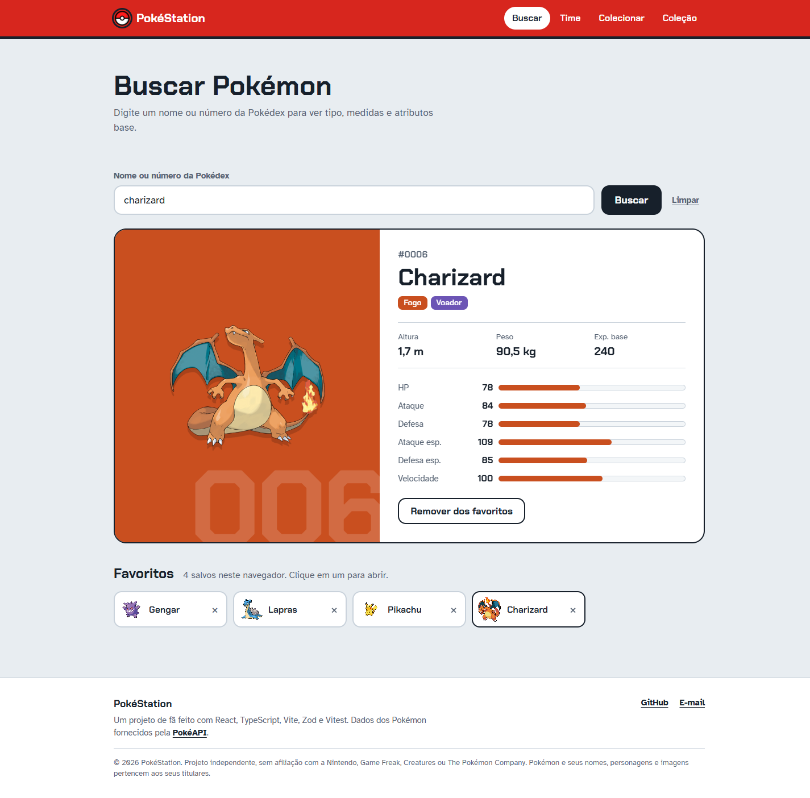
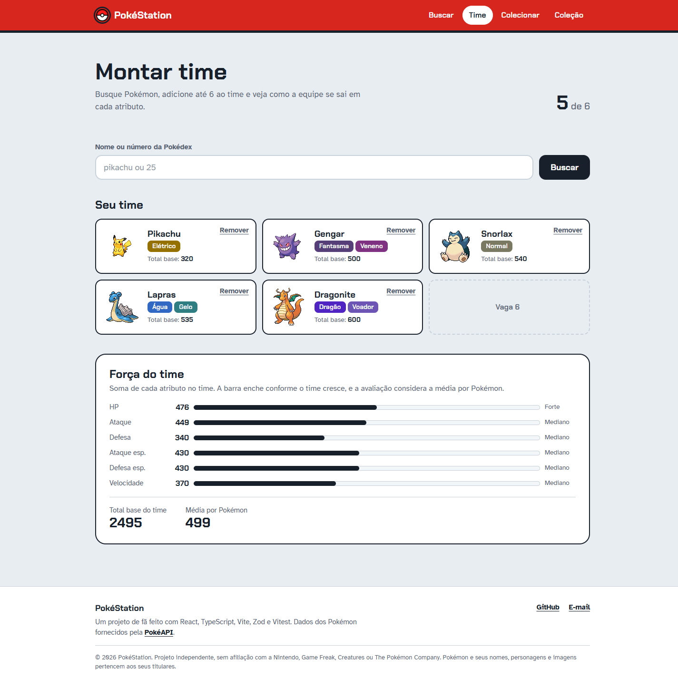
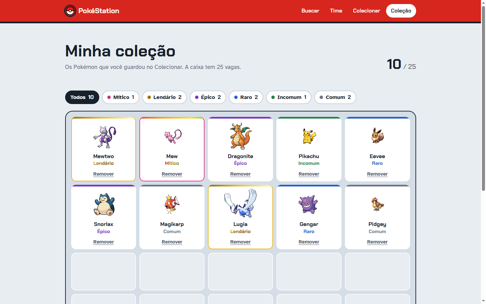

# PokéStation React v1

<p align="center">
  
</p>

<p align="center">
  
  
</p>

<p align="center">
  
</p>

PokéStation React v1 is a Pokémon-inspired web application for exploring Pokémon, building teams, discovering rarities, and managing a collection. It uses real Pokémon data from the [PokéAPI](https://pokeapi.co/), while favorites and collected Pokémon are saved locally in the browser.

# 🌐 Live Demo

<p>
  <a href="https://pokestation-react-v1.vercel.app/">
    
  </a>
</p>

Explore the application directly in your browser — no installation required!

## Project Evolution

PokéStation React v1 is the next step in the development of my original PokéStation project. The first version was built with HTML, CSS, and JavaScript. This new version rebuilds the application using React and TypeScript, with a more structured architecture and reusable components.

- **Original version:** [PokéStation — Original Project](https://github.com/EmanuBuque/Pokestation)
- **Current version:** PokéStation React v1, built with React, TypeScript, Vite, and PokéAPI.

## Features

- **Finder:** Search for a Pokémon by name or Pokédex number, see its types, height, weight and base stats as bars, and save favorites. Click a favorite to open it again.
- **Team Builder:** Build a team of up to six Pokémon. Each slot shows the Pokémon's types and base total, and the team strength panel sums every stat and rates it as weak, average or strong.
- **Collector:** Find a random Pokémon among all 1,025 and discover its rarity: Common, Uncommon, Rare, Epic, Legendary or Mythical. Legendary and Mythical encounters get an animated gold or rainbow highlight.
- **My Collection:** A 25-slot box with your saved Pokémon. Filter it by rarity or show everything again with "Todos".
- **Local persistence:** Favorites and the collection stay saved in the same browser through `localStorage`.
- **Responsive and accessible:** Works on phones, can be used with the keyboard, and respects the reduced motion setting.

## Pages

| Page | Route |
| --- | --- |
| Main Menu | `/` |
| Finder | `/finder` |
| Team Builder | `/team-builder` |
| Collector | `/collector` |
| My Collection | `/collection` |

## Technologies


## Project Structure

```
src/
├── components/   Pieces reused across pages (header, search bar, Pokédex entry, stat bars…)
├── constants/    Fixed data, like type names and colors
├── hooks/        useFavorites and useCollection: read and save data in localStorage
├── pages/        One folder per page (MainMenu, Finder, TeamBuilder, Collector, Collection)
├── services/     Calls to the PokéAPI
├── styles/       Shared button styles
├── types/        Zod schemas and TypeScript types for the API data
└── utils/        Small helper functions (rarity, team totals, display formatting)
```

Each component and page keeps its styles next to it in a `.module.css` file (CSS Modules), so class names never clash between pages.

## Requirements

- Node.js `^20.19.0` or `>=22.12.0`
- npm

## Getting Started

Clone the repository and navigate to the project directory:

```bash
git clone https://github.com/EmanuBuque/pokestation-react-v1.git
cd pokestation-react-v1
```

Install the dependencies:

```bash
npm ci
```

Start the development server:

```bash
npm run dev
```

Vite will display a local URL in the terminal where you can open the application in your browser.

## Available Scripts

| Command | Description |
| --- | --- |
| `npm run dev` | Starts the development server. |
| `npm run build` | Checks TypeScript and creates a production build. |
| `npm run preview` | Previews the production build locally. |
| `npm run lint` | Runs static code analysis with ESLint. |
| `npm run test` | Runs the test suite. |

## Images and Credits

Pokémon data is retrieved from the [PokéAPI](https://pokeapi.co/). The sprites used throughout the search, collection, and team-building pages come from API responses. Official sprites and artwork referenced by the API can be found in the [PokeAPI/sprites](https://github.com/PokeAPI/sprites) repository.

Pokémon, their names, characters, and trademarks belong to their respective owners. PokéStation is an independent fan project and is not affiliated with or endorsed by Nintendo, The Pokémon Company, or Game Freak.

## Verification

Before publishing changes, run:

```bash
npm run test
npm run lint
npm run build
```

## Copyright and License

Copyright © 2026 — PokéStation React v1  
Created by [EmanuBuque](https://github.com/EmanuBuque).

The original source code and original project assets are reserved unless otherwise stated. See [`LICENSE.md`](./LICENSE.md) for the copyright notice and usage terms.

For permission to use original project materials, please contact the author.

Third-party libraries, tools, trademarks, images, and other materials remain subject to their respective rights and terms.
