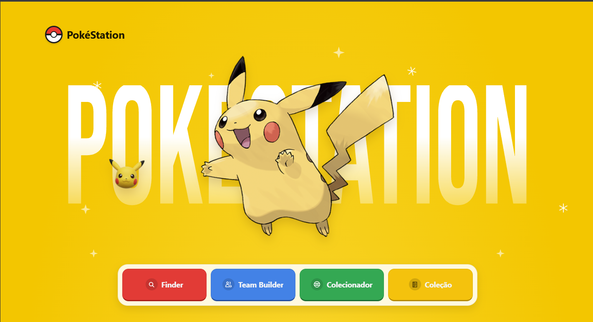

# PokéStation

<p align="center">
  
</p>

PokéStation é uma aplicação web inspirada no universo Pokémon, desenvolvida para explorar Pokémon, montar equipes e organizar uma coleção. Os dados são consultados na [PokéAPI](https://pokeapi.co/), enquanto os favoritos e a coleção ficam salvos no armazenamento local do navegador.

## Funcionalidades

- **Finder:** pesquisa Pokémon por nome, consulta informações e permite salvar Pokémon favoritos.
- **Team Builder:** monta equipes de até seis Pokémon, exibe atributos individuais e calcula o desempenho total.
- **Colecionador:** sorteia Pokémon e informa sua raridade.
- **Minha Coleção:** exibe os Pokémon capturados, permite removê-los e limita a coleção a 25 Pokémon.
- **Persistência local:** favoritos e coleção permanecem salvos no mesmo navegador por meio do `localStorage`.

## Páginas

| Página | Caminho |
| --- | --- |
| Menu principal | `/` |
| Finder | `/finder` |
| Team Builder | `/team-builder` |
| Colecionador | `/collector` |
| Minha Coleção | `/collection` |

## Tecnologias

- React 19
- TypeScript
- Vite 8
- React Router
- PokéAPI
- CSS

## Requisitos

- Node.js `^20.19.0` ou `>=22.12.0`
- npm

## Como executar localmente

Clone o repositório e entre na pasta do projeto:

```bash
git clone https://github.com/EmanuBuque/pokestation-react-v1.git
cd pokestation-react-v1
```

Instale as dependências:

```bash
npm ci
```

Inicie o servidor de desenvolvimento:

```bash
npm run dev
```

O Vite exibirá no terminal o endereço local para abrir a aplicação no navegador.

## Comandos disponíveis

| Comando | Descrição |
| --- | --- |
| `npm run dev` | Inicia o servidor de desenvolvimento. |
| `npm run build` | Verifica os tipos TypeScript e gera o build de produção. |
| `npm run preview` | Permite visualizar o build de produção localmente. |
| `npm run lint` | Executa a análise estática com ESLint. |

## Imagens e créditos

Os dados de Pokémon são consultados na [PokéAPI](https://pokeapi.co/). Os sprites utilizados nas páginas de busca, captura e equipe vêm das respostas da API. Os sprites e as artes oficiais referenciados pela API podem ser consultados no repositório [PokeAPI/sprites](https://github.com/PokeAPI/sprites).

Pokémon, seus nomes, personagens e marcas são propriedade de seus respectivos titulares. A PokéStation é um projeto independente, sem afiliação ou endosso da Nintendo, The Pokémon Company ou Game Freak.

## Verificações

Antes de publicar alterações, execute:

```bash
npm run lint
npm run build
```

## Direitos autorais

Copyright © 2026 — PokéStation React v1  
Autoria: EmanuBuque ([GitHub](https://github.com/EmanuBuque))

O código-fonte original e os elementos originais deste projeto são reservados, salvo indicação em contrário. Consulte o arquivo [`LICENSE.md`](./LICENSE.md) para conhecer o aviso de direitos reservados.

Para solicitar autorização de uso dos elementos originais, entre em contato com a autora.

Bibliotecas, ferramentas, marcas, imagens e demais materiais de terceiros continuam sujeitos aos respectivos direitos e termos aplicáveis.
